# URL Shortener — System Design

This document explains the architecture implemented in this Spring Boot codebase and the classic system-design tradeoffs behind a production URL shortener (TinyURL / bit.ly style).

> **Visual version:** Open [`SYSTEM_DESIGN.html`](SYSTEM_DESIGN.html) in a browser (Mermaid diagrams, sidebar TOC, dark theme). Export PDF via the **Save as PDF** button or the browser print dialog. Regenerate with `python3 scripts/render-design-doc.py`.

### Diagram index

| # | Diagram | Section |
|---|---------|---------|
| 1 | System context (C4-style) | [§2.1](#21-system-context) |
| 2 | Runtime / logical architecture | [§2.2](#22-runtime-architecture) |
| 3 | Layered architecture (this repo) | [§2.3](#23-layered-architecture-spring-boot) |
| 4 | Component / package map | [§2.4](#24-component-diagram) |
| 5 | Create-link flow | [§2.5](#25-create-link-sequence) |
| 6 | Redirect + analytics flow | [§2.6](#26-redirect-sequence) |
| 7 | Data model (ER) | [§5](#5-data-model) |
| 8 | Cache-aside | [§6](#6-caching-cache-aside) |
| 9 | Production scale-out | [§11](#11-scaling-sketch) |
| 10 | Local dev deployment | [§13.1](#131-local-deployment) |
| 11 | Free-tier cloud deployment | [§13.2](#132-free-tier-cloud-deployment) |

## 1. Problem statement

Given a long URL, return a short, shareable link. When a client opens the short link, redirect to the original URL quickly and reliably. Optionally track clicks and support expiration and custom aliases.

### Non-functional requirements (NFRs)

| NFR | Target in this repo | Production scale-up |
|-----|---------------------|---------------------|
| Redirect latency | &lt; 50 ms warm path (in-memory cache) | CDN edge + Redis cluster |
| Availability | Single instance + DB | Multi-AZ, no single point of failure |
| Durability | ACID writes in SQL | Same; replicas + backups |
| Read/write ratio | ~100:1 reads | Sharded read replicas, cache |
| Abuse control | Per-IP token bucket | WAF + distributed rate limits |

## 2. High-level architecture

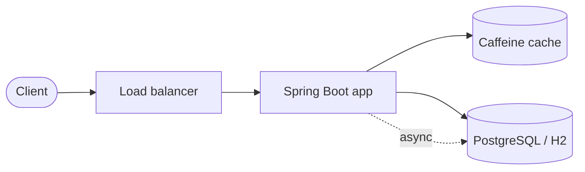

### 2.1 System context

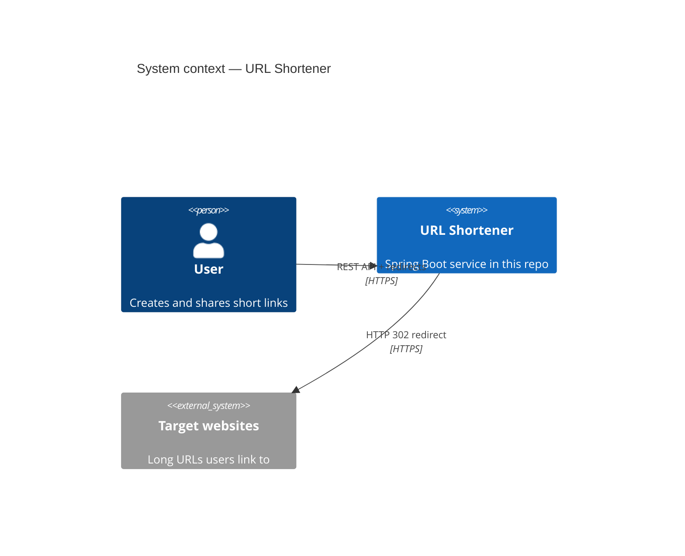

### 2.2 Runtime architecture

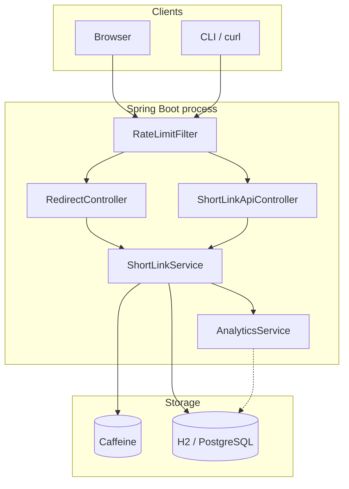

### 2.3 Layered architecture (Spring Boot)

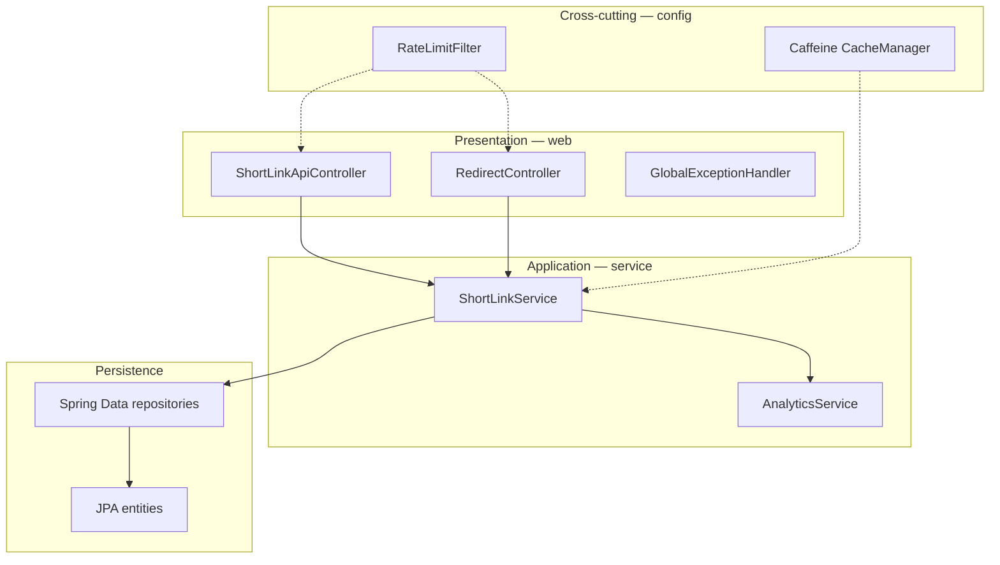

### 2.4 Component diagram

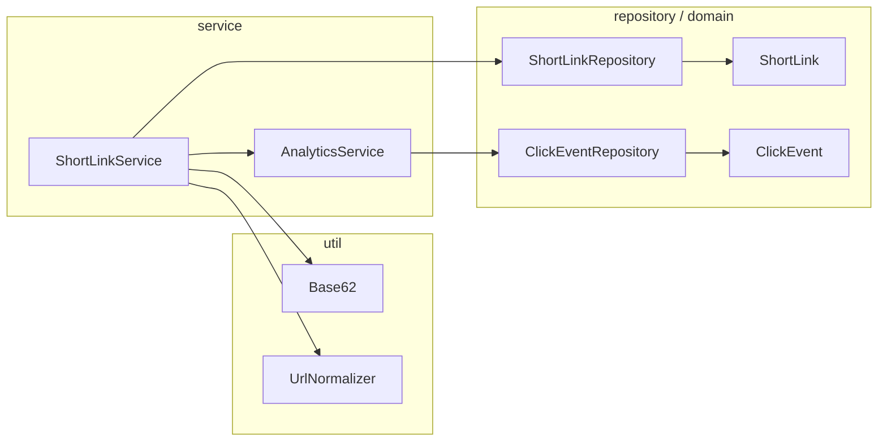

### 2.5 Create-link sequence

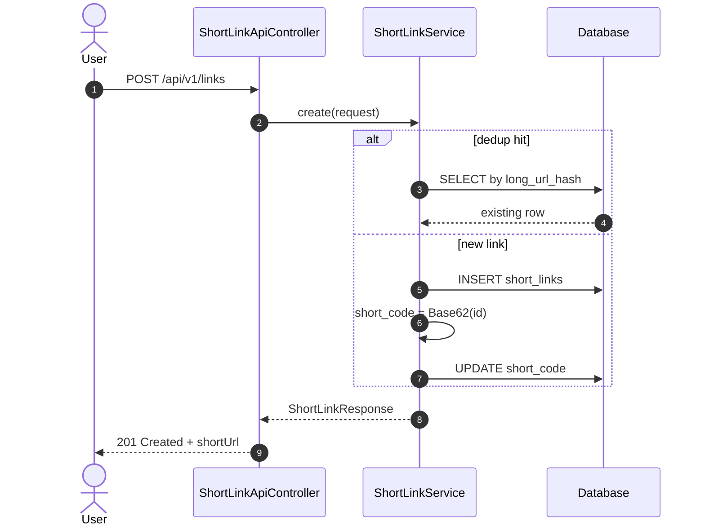

### 2.6 Redirect sequence

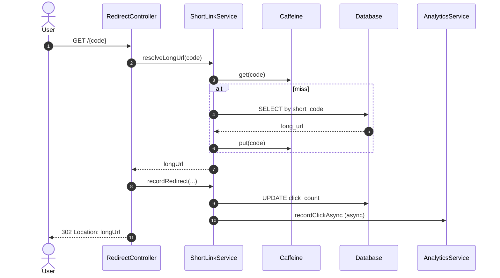

**Write path (create link):** `POST /api/v1/links` → validate URL → optional dedup by hash → insert row → assign `short_code` (Base62 of `id` or custom alias).

**Read path (redirect):** `GET /{code}` → cache-aside lookup → `302 Found` + `Location` → async click analytics.

Code map:

- `ShortLinkApiController` — REST API
- `RedirectController` — hot redirect path
- `ShortLinkService` — domain orchestration
- `Base62` — ID → short string
- `RateLimitFilter` — token bucket (Bucket4j)
- `AnalyticsService` — async `click_events` inserts

## 3. Core API design

| Method | Path | Purpose |
|--------|------|---------|
| `POST` | `/api/v1/links` | Create short link |
| `GET` | `/api/v1/links/{code}` | Metadata |
| `GET` | `/api/v1/links/{code}/stats` | Clicks + event count |
| `GET` | `/{code}` | Redirect (302) |
| `GET` | `/swagger-ui.html` | OpenAPI UI |
| `GET` | `/actuator/health` | Health check (deploy) |

### Create request

```json
{
  "longUrl": "https://example.com/very/long/path",
  "customAlias": "launch",
  "ttlDays": 30
}
```

### Why 302 instead of 301?

- **301** is aggressively cached by browsers → hard to change destination or count clicks accurately.
- **302** (used here) allows updated targets and analytics on each visit (unless intermediaries cache).

## 4. Short code generation

### Approach A (implemented): Database sequence + Base62

1. Insert row (temporary code).
2. Use auto-generated `id`.
3. Set `short_code = Base62(id)`.

**Pros:** No collisions, O(1), monotonic, simple sharding key (`id`).

**Cons:** Codes leak insert order (sometimes undesirable); DB must allocate IDs.

See `Base62.java` and `ShortLinkService.create()`.

### Approach B (alternative): Random / hash

Hash URL + salt → truncate → retry on collision. Used when you want opaque, non-sequential codes without a central ID allocator.

### Approach C: Custom alias

User-provided vanity path; uniqueness enforced with DB unique index → `409 Conflict` (`AliasConflictException`).

## 5. Data model

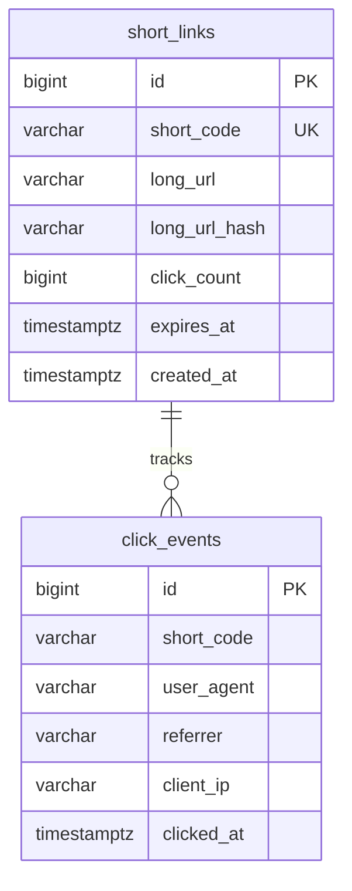

- **`long_url_hash`:** SHA-256 of normalized URL for deduplication (`app.deduplicate-long-urls`).
- **`click_count`:** denormalized counter (fast stats); `click_events` for raw audit trail.
- **Indexes:** unique on `short_code`; index on `long_url_hash` for dedup lookups.

Schema: `src/main/resources/db/migration/V1__schema.sql` (Flyway).

## 6. Caching (cache-aside)

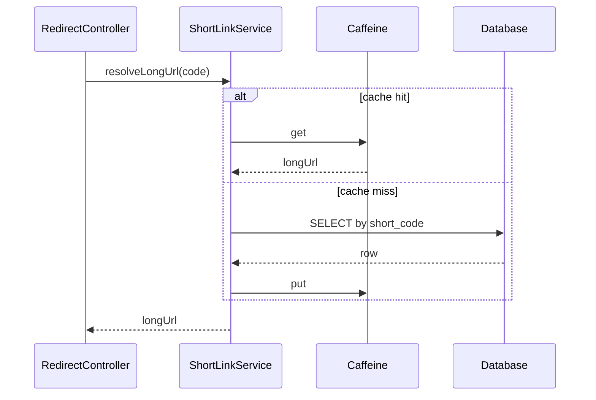

- **TTL:** `app.cache.redirect-ttl-seconds` (default 300s).
- **Eviction:** Caffeine size cap `app.cache.maximum-size`.
- **Production:** replace with **Redis** (shared across instances); same cache-aside pattern.

**Consistency note:** Stale cache may serve an old URL for up to TTL after a rare update (this service does not support URL edits; if added, use cache invalidation on write).

## 7. Analytics and async processing

Redirects must stay fast. Click recording:

1. Synchronous: `UPDATE click_count` (single row, cheap).
2. Asynchronous: insert into `click_events` via `@Async` executor (`clickEventExecutor`).

This is a minimal **eventual consistency** split: counter and event log may briefly diverge under failure; production would use a message queue (Kafka/SQS) for durable analytics.

## 8. Rate limiting

`RateLimitFilter` implements a **token bucket** per client IP (Bucket4j).

- **Single instance:** in-memory `ConcurrentHashMap` of buckets.
- **Multiple instances:** buckets must live in Redis (same algorithm, shared state) or at the edge (Cloudflare, API Gateway).

Returns `429` with `{"error":"rate_limit_exceeded"}`.

## 9. URL normalization & security

`UrlNormalizer`:

- Trims input, prepends `https://` when scheme missing.
- Parses with `URI` to ensure a host exists.

**Production hardening (not all implemented):**

- Block private IPs (`127.0.0.1`, `10.x`, metadata endpoints) to prevent SSRF on redirect.
- Malware/phishing scanning async on create.
- Signed admin APIs for takedowns.

## 10. CAP theorem & database choice

- **Creates** need **consistency** (unique `short_code`, durable mapping).
- **Redirects** favor **availability** + latency; tolerate cache staleness.

**SQL (PostgreSQL)** provides strong consistency for writes and indexed point reads. At scale:

- **Primary** for writes.
- **Read replicas** for redirect lookups (accept replication lag) or cache-first reads.

**H2 file mode** (`local` profile) = zero-cost local/dev; switch `postgres` profile for Neon/Supabase/Railway free Postgres.

## 11. Scaling sketch

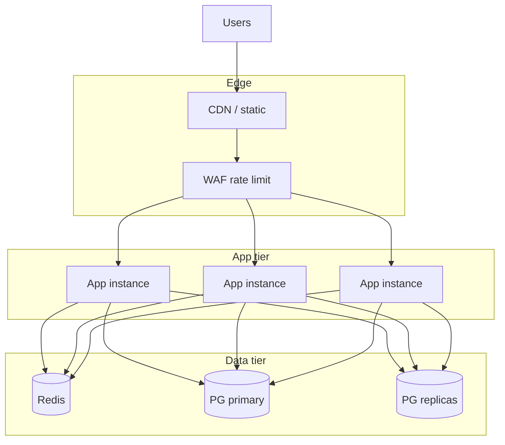

| Bottleneck | Symptom | Mitigation |
|------------|---------|------------|
| Redirect QPS | High CPU on DB | Redis + local cache, read replicas |
| Hot short link | Single key fan-out | CDN cache redirect (careful with 302) |
| Write QPS | Primary DB load | Shard by `id` range / hash of `short_code` |
| Storage | Billions of rows | Tiered storage, TTL, archive `click_events` |

### Sharding strategies

- **By `short_code` hash:** `shard = hash(code) % N`.
- **By `id` range:** sequential IDs map cleanly to Base62.

## 12. Capacity estimation (back-of-envelope)

Assume:

- 100M links created / month
- 10B redirects / month (~3.8k RPS average, higher peak)

**Storage (links only):** ~500 bytes/row → 50 GB/month for new links (before indexes).

**Redirect bandwidth:** dominated by HTTP headers, not body — cache and edge termination matter more than app servers.

## 13. Deployment (free tier)

This repo ships:

- `Dockerfile` — container image (Render, Railway, Fly.io).
- `docker-compose.yml` — local Postgres.
- `render.yaml` — example Render blueprint.

Typical env:

```bash
SPRING_PROFILES_ACTIVE=postgres
DATABASE_URL=jdbc:postgresql://host/db?sslmode=require
DATABASE_USERNAME=...
DATABASE_PASSWORD=...
APP_BASE_URL=https://your-service.onrender.com
PORT=8080
```

**Free-tier stack example:** Render web service (free) + Neon Postgres (free) + no Redis (Caffeine only on one instance).

### 13.1 Local deployment

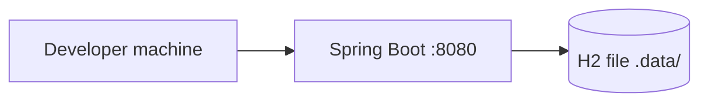

### 13.2 Free-tier cloud deployment

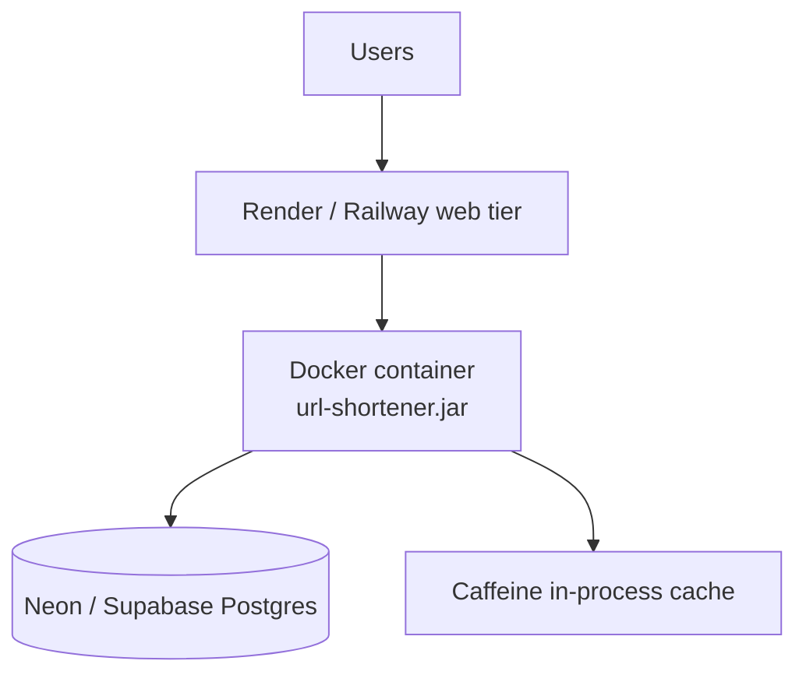

## 14. Observability

Spring Boot Actuator:

- `/actuator/health` — liveness/readiness
- `/actuator/metrics` — JVM, HTTP, cache stats
- `/actuator/caches` — Caffeine hit rate

**Production adds:** RED metrics (Rate, Errors, Duration), structured logs with `short_code`, tracing (OpenTelemetry).

## 15. Failure modes

| Failure | Behavior | Mitigation |
|---------|----------|------------|
| DB down | Creates fail; redirects miss cache then fail | HA Postgres, circuit breaker |
| Cache poison N/A | — | TTL bounds staleness |
| Async analytics lag | Stats undercount briefly | Queue + retry |
| Clock skew | Expiry edge cases | UTC everywhere (`hibernate.jdbc.time_zone`) |

## 16. Concepts checklist (interview map)

- [x] REST API design & idempotency (dedup by URL hash)
- [x] Horizontal scaling readiness
- [x] Cache-aside, TTL, eviction
- [x] SQL schema, indexes, unique constraints
- [x] Base62 / ID generation tradeoffs
- [x] 301 vs 302 redirects
- [x] Rate limiting (token bucket)
- [x] Async decoupling (analytics)
- [x] Flyway migrations
- [x] Health checks for PaaS
- [x] CAP / read-write splitting (documented)
- [ ] CDN, Redis cluster, Kafka (documented as scale path)

## 17. Suggested experiments

1. Load-test redirects with `hey` or `k6`; watch cache hit ratio via Actuator.
2. Disable cache TTL to 0 mentally — compare DB QPS.
3. Deploy two instances without Redis; observe divergent rate limits (why shared state matters).
4. Add Redis cache provider implementing the same `resolveLongUrl` pattern.
5. Change redirect to `301` and observe browser behavior vs stats.

---

*Implementation package:* `com.example.urlshortener` under `url-shortener/`.
